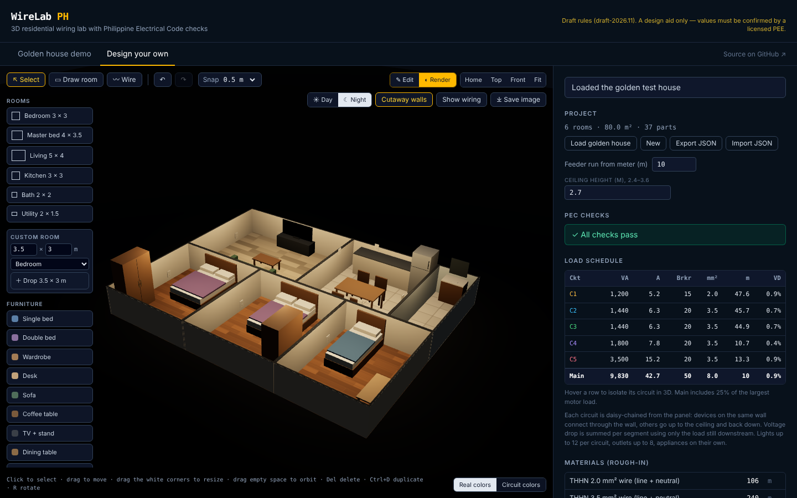
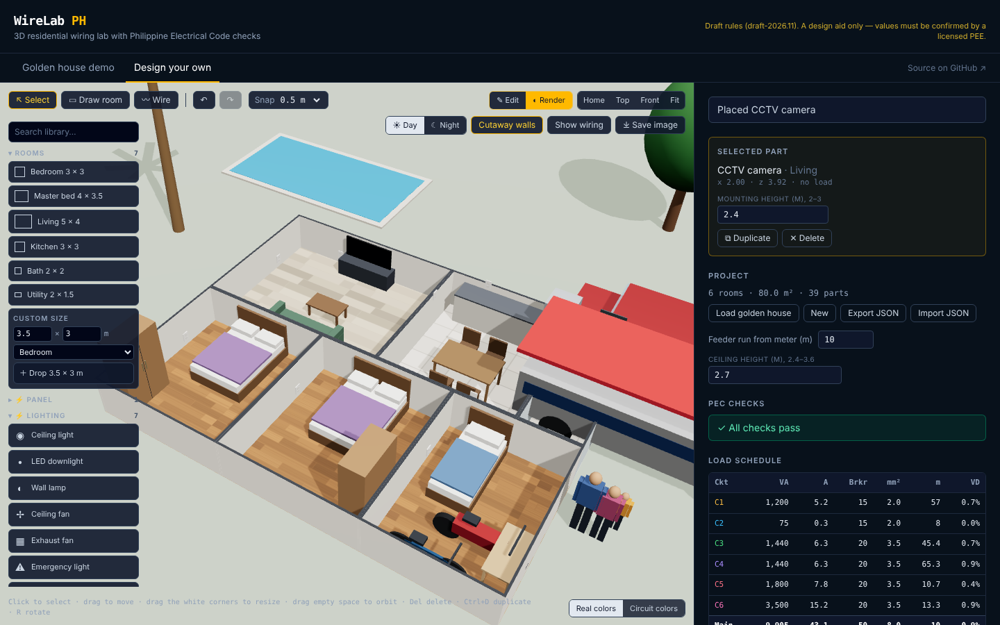
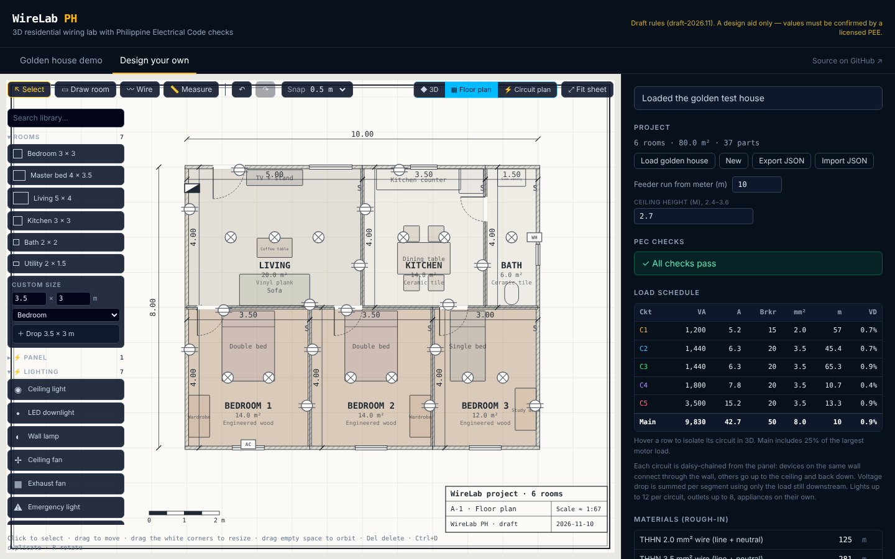
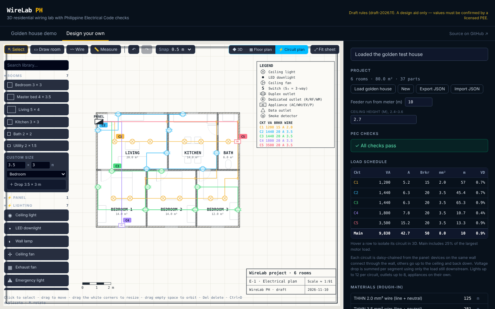

# WireLab PH

A browser 3D wiring lab for Filipino electrical engineers: place parts in a house, wire them into circuits, and get Philippine Electrical Code (PEC 2017) checks — load schedule, breaker and wire sizing, voltage drop — plus a breaker-trip demo for clients and trainees.

**Live demo:** https://ashweak.github.io/wirelab/










## What works now

- 3D golden test house (3-bedroom bungalow, 80 m², 5 circuits, 30 parts) with color-coded wiring
- PEC engine: load, current, breaker, wire size, voltage drop, main and feeder
- Live checks with suggested fixes: `VD-BRANCH-3`, `VD-TOTAL-5`, `WIRE-UNDERSIZED`, `OVERLOAD`, `DEDICATED-CIRCUIT`
- Fail/fix scenarios that show each check firing and clearing
- Demo mode: plug appliances into the bedroom circuit until its breaker trips
- **Realistic wiring:** daisy-chained circuits in orange PVC conduit, through-the-wall runs between devices on the same wall, junction boxes at ceiling drops, wall switches, a Wire tool to set the wiring order by hand, per-segment voltage drop, and a rough-in materials list (wire by size, conduit, boxes, breakers)
- **Tinkercad-style editor:** drag rooms and electrical parts from a shape library onto the work plane; click to select, drag to move, pull corner handles to resize, rotate 90°, duplicate, copy/paste, delete; edit name, type, size and mounting height in a properties panel; undo/redo, snap grid 0.1–1 m, Home/Top/Front/Fit views, keyboard shortcuts (Del, Ctrl+D, Ctrl+Z, Ctrl+Shift+Z, R, arrows)
- **Full library (searchable):** ~100 items in 12 groups — bedroom, living, dining, kitchen, bath, office, commercial, architecture (doors, windows, stairs, ramps, columns, railings, partitions), outdoor (trees, palms, pool, fence), utility, people for scale, and vehicles (sedan, SUV, pickup, van, jeepney, truck, motorcycle, tricycle, bicycle); any size from 5 cm to 30 m; outdoor placement
- **25 electrical devices:** lights, downlights, sconces, ceiling/exhaust fans, emergency lights, smoke detectors, doorbell, 1- and 3-way switches, duplex/GFCI/weatherproof/floor outlets, aircon, water heater, range, refrigerator, washer, water pump, EV charger, data, TV and CCTV — each on the right circuit type
- **Construction materials:** wall systems (CHB 4"/6", AAC, clay brick, cast concrete, gypsum drywall, fiber cement, plywood) drawn at their real thickness; 10 floor finishes (ceramic, porcelain, granite, marble, vinyl, engineered wood, parquet, polished concrete, epoxy, carpet tile); 6 ceiling systems; door and window types (panel, flush, PVC, folding, roll-up; awning, casement, sliding, jalousie, fixed, transom) that snap into walls; a construction estimate (CHB, cement, sand, boards, studs, tiles, adhesive) with openings deducted
- **Floor plan & circuit plan:** editable 2D sheets with border and title block, hatched walls, door swings, windows, room and overall dimensions, standard electrical symbols, colour-coded circuit runs, legend, panel schedule and scale bar; pan/zoom and the same select/move/resize tools as 3D
- **Measure tool** in every view, and a toolbar on any clicked object (rotate, copy, raise/lower, size, delete)
- **Interior + render:** 14 furniture pieces you can size, recolour and rotate; floor finish (tile, wood, vinyl, concrete) and wall paint per room; custom room size; ceiling height that updates the wire runs; a render mode with soft shadows, studio lighting, procedural floor textures, day/night (ceiling lights light the rooms at night), cutaway walls and PNG export
- **Design your own:** draw rooms on a grid, place panel, lights, outlets, aircon and water heater (snapped to code mounting heights), and get auto-grouped circuits with a live load schedule; undo, autosave, JSON import/export

## Built backward from a spec

[`SPEC.md`](SPEC.md) defines the finished result first — a golden house with exact expected values and must-fail cases. Those values are the tests in [`src/engine/engine.test.ts`](src/engine/engine.test.ts); each build step is done when its tests pass.

## Stack

Next.js (static export) · TypeScript · React Three Fiber / drei · Tailwind · Vitest · GitHub Actions → GitHub Pages

## Run locally

```bash
npm install
npm test        # engine tests
npm run dev     # http://localhost:3000
```

## Disclaimer

Rule values in [`src/engine/rules.ts`](src/engine/rules.ts) are a **draft** and must be confirmed by a licensed Professional Electrical Engineer. WireLab is a design aid; it does not replace a PEE's signed plan.

---

Built by [Lance Agua](https://ashweak.github.io).
