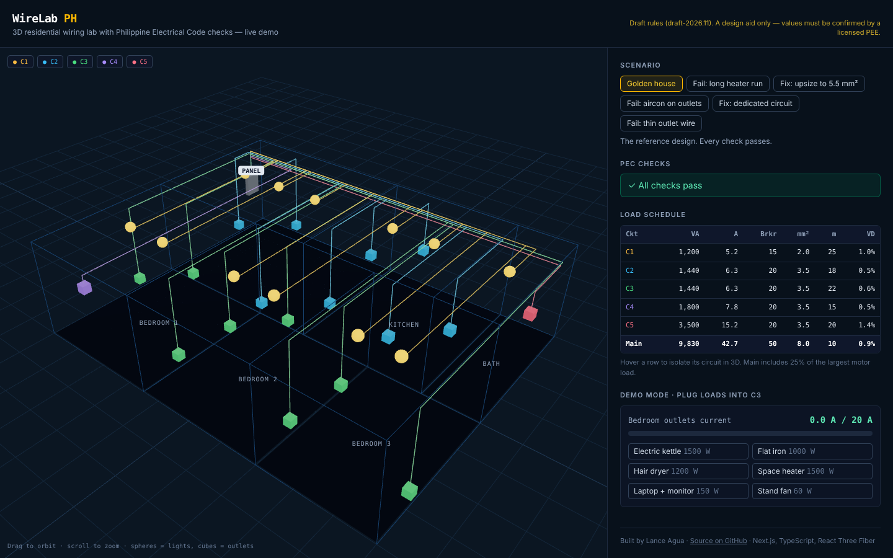

# WireLab PH

A browser 3D wiring lab for Filipino electrical engineers: place parts in a house, wire them into circuits, and get Philippine Electrical Code (PEC 2017) checks — load schedule, breaker and wire sizing, voltage drop — plus a breaker-trip demo for clients and trainees.

**Live demo:** https://ashweak.github.io/wirelab/



## What works now

- 3D golden test house (3-bedroom bungalow, 80 m², 5 circuits, 30 parts) with color-coded wiring
- PEC engine: load, current, breaker, wire size, voltage drop, main and feeder
- Live checks with suggested fixes: `VD-BRANCH-3`, `VD-TOTAL-5`, `WIRE-UNDERSIZED`, `OVERLOAD`, `DEDICATED-CIRCUIT`
- Fail/fix scenarios that show each check firing and clearing
- Demo mode: plug appliances into the bedroom circuit until its breaker trips
- **Design your own:** draw rooms on a grid, place panel, lights, outlets, aircon and water heater (snapped to code mounting heights), and get auto-grouped circuits with a live load schedule; undo, autosave, JSON import/export

## Built backward from a spec

[`SPEC.md`](SPEC.md) defines the finished result first — a golden house with exact expected values and must-fail cases. Those values are the tests in [`src/engine/engine.test.ts`](src/engine/engine.test.ts); each build step is done when its tests pass.

## Stack

Next.js (static export) · TypeScript · React Three Fiber / drei · Tailwind · Vitest · GitHub Actions → GitHub Pages

## Run locally

```bash
npm install
npm test        # engine tests
npm run dev     # http://localhost:3000
```

## Disclaimer

Rule values in [`src/engine/rules.ts`](src/engine/rules.ts) are a **draft** and must be confirmed by a licensed Professional Electrical Engineer. WireLab is a design aid; it does not replace a PEE's signed plan.

---

Built by [Lance Agua](https://ashweak.github.io).
